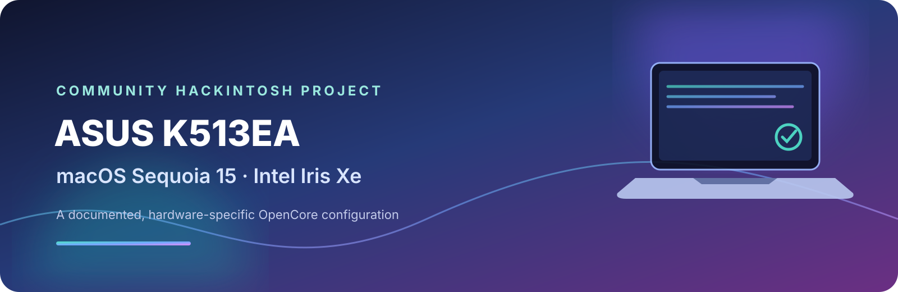

# ASUS VivoBook K15 OLED · Hackintosh

### macOS Sequoia 15 · Intel Tiger Lake · Iris Xe

**A hardware-specific community project for the ASUS VivoBook K15 OLED K513EA.**

[Getting Started](#-getting-started) · [Hardware](#-hardware) · [Compatibility](#-compatibility-roadmap) · [Downloads](#-downloads) · [Issues](../../issues)

---

## ✨ Project overview

This repository documents and maintains an EFI configuration for the **ASUS VivoBook K15 OLED K513EA**, based on the owner's supplied setup.

The owner reports that the supplied EFI boots and that graphics acceleration is working. The configuration is being preserved as the baseline while its components and macOS compatibility are documented and validated.

> [!IMPORTANT]
> This is an experimental Hackintosh project, not an official Apple-supported installation. A successful boot on one machine does not guarantee that every hardware feature works on every K513EA variant.

## 💻 Hardware

| Component | Configuration |
|---|---|
| Laptop | ASUS VivoBook K15 OLED K513EA |
| Processor | Intel Core i5-1135G7 · Tiger Lake-U |
| Integrated graphics | Intel Iris Xe |
| Memory | 8 GB (owner-reported) |
| Display | Built-in OLED |
| Wireless | Realtek (exact chipset ID still to be confirmed) |
| Bootloader | OpenCore (version to be confirmed from EFI) |
| Primary OS target | macOS Sequoia 15 |

## 🧭 Compatibility roadmap

| macOS generation | Project status | Policy |
|---|---|---|
| **Sequoia 15** | 🟡 Primary target | Preserve supplied EFI; validate exact build and hardware |
| **Tahoe 26** | ⚪ Planned | Separate compatibility profile; do not assume Sequoia EFI works unchanged |
| **macOS 27** | ⚪ Future | Enable only after upstream support and real testing |

**Graphics note:** Iris Xe acceleration is owner-reported as working in the supplied setup. Metal 3 support is **not established**. Graphics acceleration, Metal API availability, and individual Metal feature sets are different claims and must be tested separately.

## 📦 Downloads

- **EFI release assets:** [Open Releases](../../releases) and download the asset attached to the Sequoia release.
- **Source and documentation:** Browse this repository.
- The downloadable EFI is a sanitized distribution copy; generate your own unique SMBIOS identity locally before use.

Before using an EFI, inspect its configuration and create a backup of your current working EFI.

## 🚀 Getting started

1. Read this README and the compatibility notes.
2. Download the EFI archive from **Releases**, when available.
3. Keep a backup of your existing EFI and important data.
4. Generate your own unique SMBIOS identity (Serial Number, MLB, SystemUUID and ROM) using appropriate OpenCore tooling. Never reuse identifiers from another person's EFI.
5. Review the config, ACPI, drivers and kext versions for your exact hardware and macOS build.
6. Test from a separate USB EFI first. Do not overwrite your internal boot setup until the USB test is successful.

> [!CAUTION]
> Never publish your generated SMBIOS values. Do not erase, repartition, or modify Windows boot files as part of EFI testing.

## 🧩 What is being tracked

- [x] Owner-supplied EFI received
- [x] Privacy-scrubbed distribution copy prepared (SMBIOS fields neutralized)
- [x] Initial project README
- [ ] Confirm exact macOS Sequoia build and successful boot evidence
- [ ] Inventory OpenCore, drivers, ACPI and every kext version
- [ ] Confirm exact Wi-Fi, Bluetooth, audio and touchpad hardware IDs
- [ ] Validate brightness, battery, USB, sleep/wake and power management
- [ ] Document graphics configuration and Metal feature support
- [ ] Add reproducible validation/build scripts
- [ ] Create separately tested Tahoe 26 profile
- [ ] Evaluate future macOS 27 compatibility when upstream support exists

## 🔐 Privacy & distribution

The prepared public EFI copy has the following SMBIOS fields neutralized:

- `SystemSerialNumber`
- `MLB`
- `SystemUUID`
- `ROM`

This is a privacy precaution, not a ready-to-use generated SMBIOS identity. Configure unique values locally before using services that require a valid SMBIOS identity. Always inspect the complete EFI for other personal data before redistribution.

## 🤝 Contributing / reporting issues

When reporting a problem, include:

- Exact K513EA variant and hardware IDs
- macOS version and build number
- OpenCore version
- Relevant kext versions
- A sanitized config excerpt or log

**Do not attach serial numbers, MLB, ROM, UUID, passwords, personal files, or unredacted logs.**

## 📚 Upstream references

- [OpenCorePkg](https://github.com/acidanthera/OpenCorePkg)
- [WhateverXe](https://github.com/b00t0x/WhateverXe)
- [WhateverXe-Graphics](https://github.com/b00t0x/WhateverXe-Graphics)
- [Dortania OpenCore Install Guide](https://dortania.github.io/OpenCore-Install-Guide/)

All upstream projects retain their own licenses and documentation. This repository does not claim affiliation with ASUS, Apple, Intel, or the upstream developers.

## ⚖️ Disclaimer

This project is provided **as-is**, for research and educational use. No warranty is provided. You are responsible for backups, hardware compatibility checks, and compliance with applicable software terms and laws.

**Made for the K513EA · Maintained with care**

